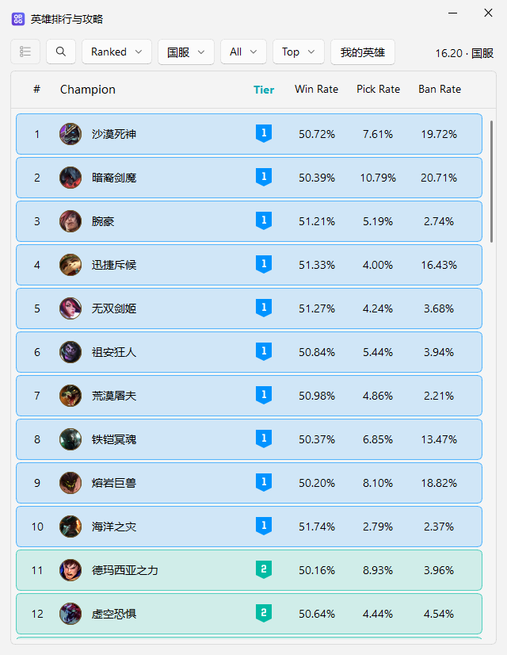

# LOL 战绩助手

基于 [Seraphine](https://github.com/Zzaphkiel/Seraphine) 的 Windows 桌面修改版，面向国服英雄排行、战绩查询和选人辅助。



## 当前功能

- 查询战绩，查看国服英雄排行、英雄攻略和海克斯数据。
- 海克斯选人阶段读取备选席与自己的当前英雄，按胜率置顶，并标记前三名。
- 按账号整理个人分路英雄榜，使用顶部按钮切页查看。
- 海克斯攻略图标优先复用本地缓存，缺图后台补齐。

当前界面已移除占据排行空间的 Counter 对位面板和局内海克斯小窗。尚未实现游戏画面中的三个候选海克斯自动识别。

旧的 ARAM Home 增益服务为可选功能，接口密钥从 `SERAPHINE_ARAM_APP_SECRET` 环境变量读取，源码不内置密钥。未配置时跳过该服务的网络更新，不影响腾讯英雄排行和海克斯攻略。

## 运行源码

需要 Windows 和 Python 3.11，运行时先打开英雄联盟客户端。

```powershell
python -m venv .venv
.\.venv\Scripts\python.exe -m pip install -r Seraphine/requirements.txt
.\.venv\Scripts\python.exe Seraphine/main.py
```

已有本地开发环境时，可使用根目录的「启动源码版.cmd」。启动器优先使用 `.venv`，也兼容本地已有的 `packaging-env` 环境。修改源码后重启即可，不需要每次打包。

## 下载与更新

当前仓库首先发布源码，尚未提供本次修改版的 Windows 安装包。正式发布时会把完整的 `Seraphine.7z` 上传到本仓库 [Releases](https://github.com/OldFarmCoder-JJ/lol-record-assistant/releases)。

更新检查入口已指向本仓库。没有 Release 或没有匹配安装包时，不提示安装更新。推送源码不会自动改变别人已下载的 EXE；Windows 包发布和升级替换流程还需正式发布前验证。

GitHub Actions 只保留手动源码检查，不会在每次推送时自动打包。

## 开发验证

```powershell
.\.venv\Scripts\python.exe verify_compact_ranking.py
.\.venv\Scripts\python.exe verify_personal_history.py
.\.venv\Scripts\python.exe verify_github_updates.py
```

界面收简后已用连接中的客户端验证实时国服排行。训练房创建接口返回错误，尚未通过真实训练对局验证。测试截图中的排行数据来自腾讯 101，日期与版本以界面标注为准。

## 来源与许可

原项目：[Zzaphkiel/Seraphine](https://github.com/Zzaphkiel/Seraphine)。本仓库保留原作者声明和 GPL-3.0 许可，修改部分同样按 GPL-3.0 提供。详见 [LICENSE](LICENSE)。游戏名称、美术素材和第三方数据归各自权利人所有。
