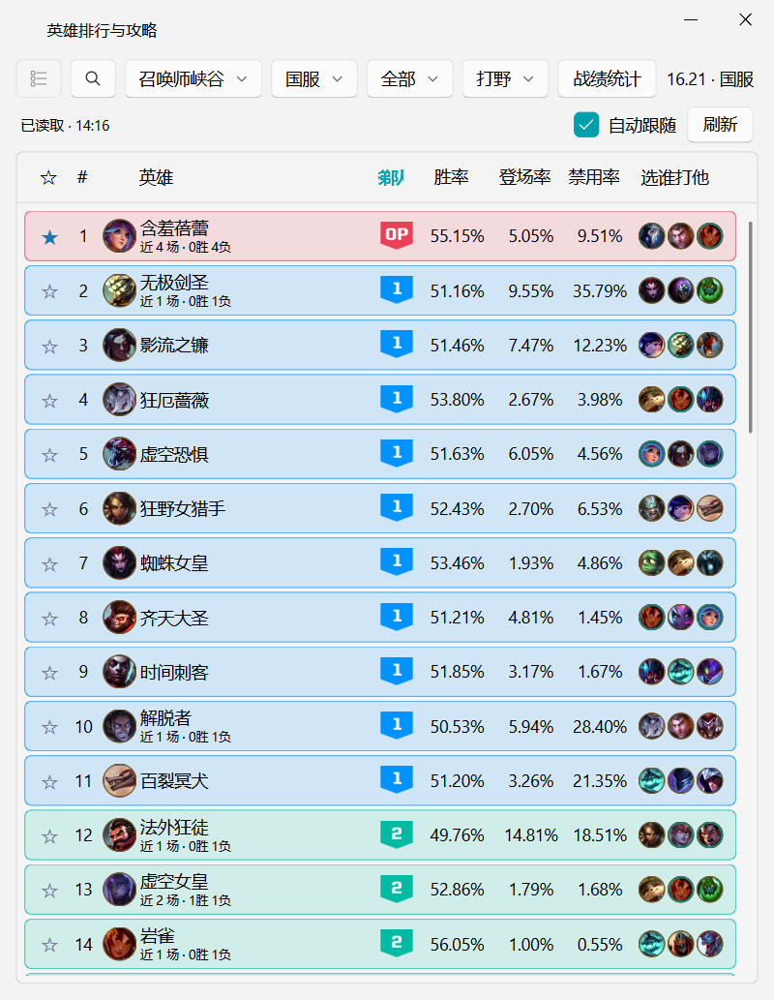
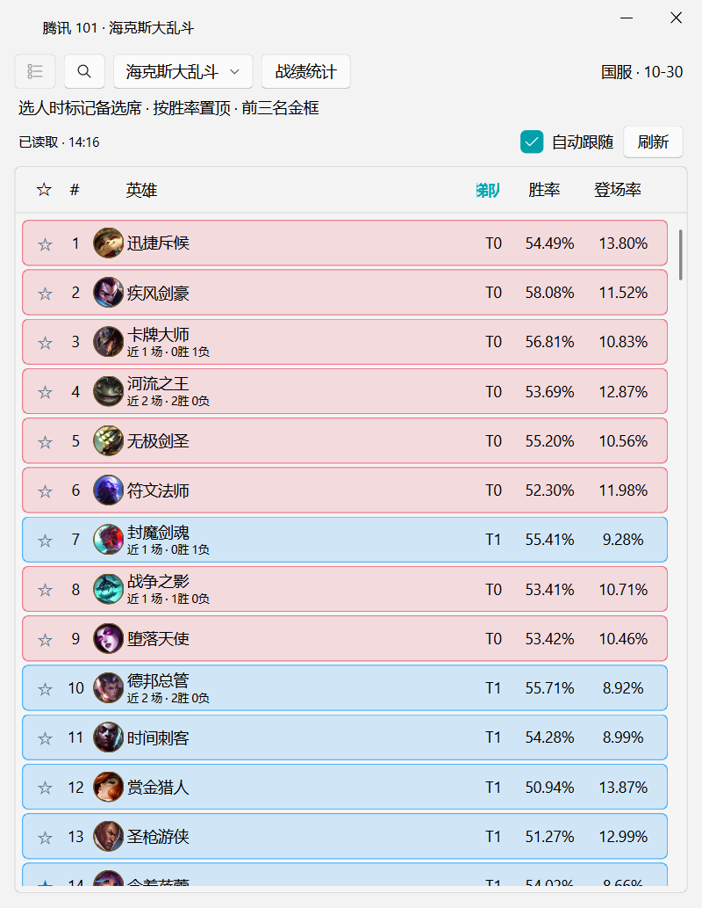
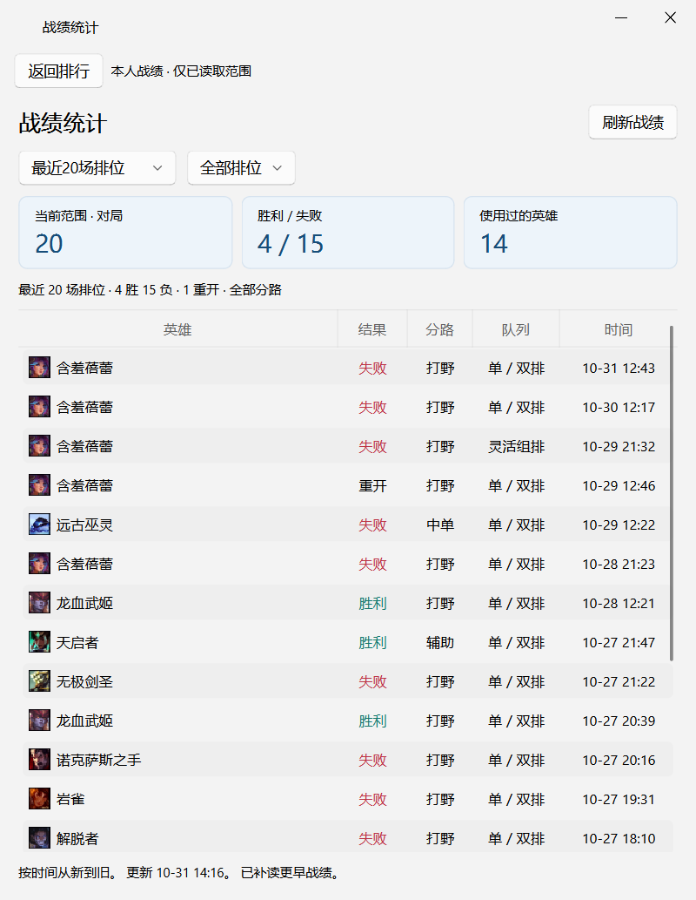
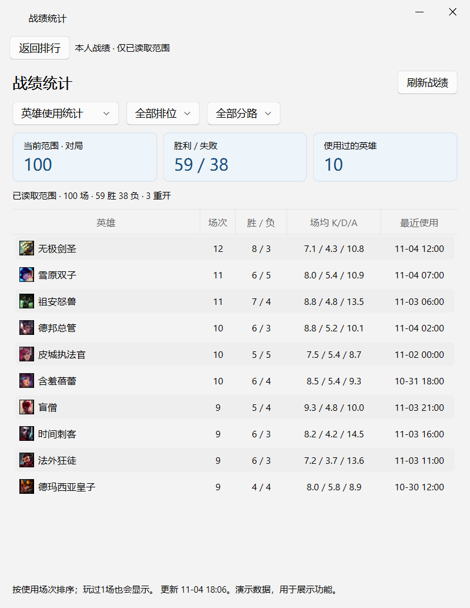
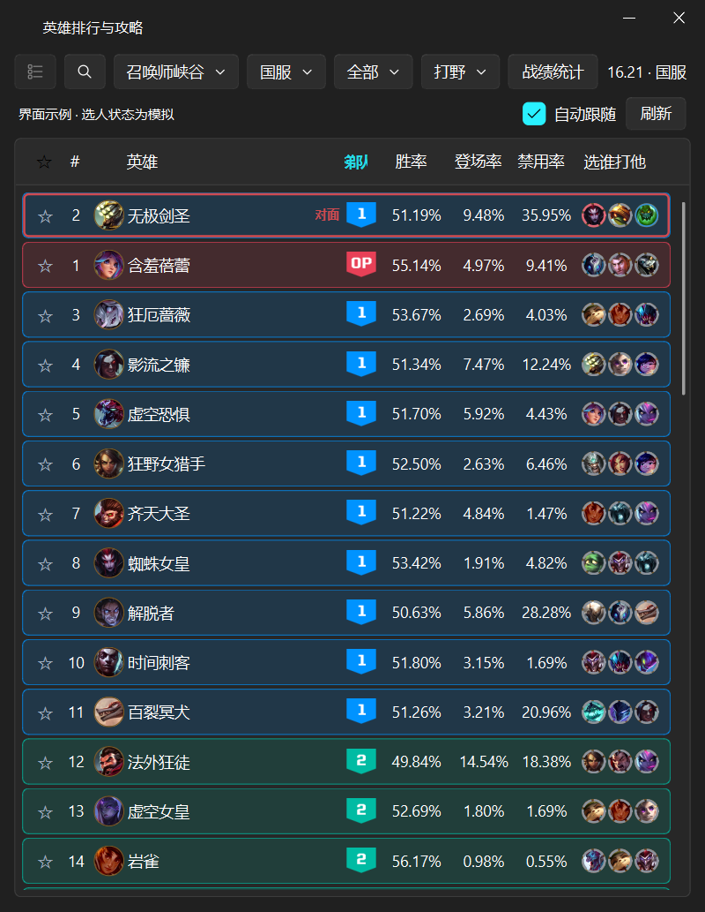

# Seraphine · LOL 战绩助手

基于 [Seraphine](https://github.com/Zzaphkiel/Seraphine) 的 Windows 英雄联盟战绩查询与选人参考工具，面向国服玩家。

**LOL查战绩 · 英雄排行 · Counter 克制参考 · 海克斯大乱斗 · 个人战绩统计**

[](https://github.com/OldFarmCoder-JJ/lol-record-assistant/releases/latest)
[](https://github.com/OldFarmCoder-JJ/lol-record-assistant/releases/latest)
[](LICENSE)

**[下载 Windows 完整包](https://github.com/OldFarmCoder-JJ/lol-record-assistant/releases/latest/download/Seraphine.zip)** · [更新记录](https://github.com/OldFarmCoder-JJ/lol-record-assistant/releases) · [反馈问题](https://github.com/OldFarmCoder-JJ/lol-record-assistant/issues)

## 下载与使用

1. 下载 **[Seraphine.zip](https://github.com/OldFarmCoder-JJ/lol-record-assistant/releases/latest/download/Seraphine.zip)**，完整解压到一个文件夹。
2. 打开英雄联盟客户端，再运行文件夹中的 **`Seraphine.exe`**。
3. 打开「英雄排行与攻略」，选择峡谷或海克斯大乱斗；点击「战绩统计」查看本人的近期记录。

保留解压后的 `_internal` 目录，程序需要其中的文件。Windows 完整包无需安装 Python。首次使用需要联网加载游戏资源，后续会复用本地缓存。

## 看图了解功能

### BP大师：后选时参考双方阵容

打开「英雄排行与攻略」，峡谷选人时窗口顶部会显示 BP大师。对面每锁定一名英雄，面板就按你的分路更新最多三个候选，并说明理由，例如限制普攻、反制突进或保护己方后排。客户端没有分配位置时，使用窗口里手选的分路。锁定自己的英雄后，面板自动收起。

打野位先看敌方打野的同路克制榜，榜内候选优先，再按双方阵容和个人英雄池排序。助手优先读取敌方已锁英雄的分路或惩戒；仅有一个常见打野时标为推测，有歧义时可用「指定打野」选择对手。缺少可用对位数据时会标明回退原因。

候选会排除已禁、已锁和客户端明确不可选的英雄。分路榜可用时结合榜单及同路克制资料，榜单尚未加载时使用内置常见英雄。收藏和近期排位记录会给适配程度接近的英雄加权。推荐理由来自阵容规则；「若同路」表示对手实际分路仍待确认。

### 峡谷排行：看强度，也看选谁打他

按分路查看英雄排行、胜率、登场率与禁用率，支持国服、全球和韩服数据。右侧「选谁打他」用紧凑头像展示克制参考，**点击头像直接打开该英雄攻略**，也支持 Tab 聚焦后按回车或空格打开。

选人时，对面已锁定且出现在当前分路榜中的英雄会自动置顶、加红框，并保留原始名次，减少手动翻榜。该标记不代表已确认对方分路；表中的胜率仍是英雄整体胜率。

克制头像上的**红色虚线环**表示已禁用，**灰色虚线环**表示已选或暂不可选；悬停查看具体状态。客户端没有提供可选信息时保留“未确认”，不会把缺失数据当作未拥有。仍可打开这些英雄的攻略作参考。



### 海克斯大乱斗：在备战席里挑英雄

读取选人阶段的备选席与自己的当前英雄，在排行榜中按胜率置顶，并为前三名加上金框。选英雄时可以直接比较当前能拿到的选择，也可以查看英雄攻略与海克斯数据。

下图用模拟备战席演示按胜率置顶与前三金框，排行数值来自公开数据接口。



### 最近对局：20／50／100场，按队列回顾

切换最近 **20／50／100场**，查看英雄、胜负、**K/D/A、对局时长**、分路、队列与时间。可分别筛选全部排位、单／双排、灵活组排或海斗；记录不足时尝试补读，并按实际场次展示。

重开单独标注。接口没有提供的KDA和时长显示“—”，旧缓存刷新后可补齐近期记录。



### 英雄使用统计：最近玩了谁，打得怎么样

按使用场次整理近期英雄，显示胜负、**场均K/D/A**与最近使用时间，支持队列和分路筛选。玩过1场也会显示，方便回顾自己的英雄选择。

统计仅覆盖当前账号已读取的记录；重开和待确认结果单独统计，因此胜负之和可能小于总场次。场均KDA仅使用有完整数据的非重开对局，悬停可查看样本场次。



### 收藏、跟随与主题

- **收藏不挡头像**：星标位于独立一列，也支持右键收藏；收藏随当前账号分别保存。
- **自动跟随模式与分路**：选人时跟随海斗／峡谷及客户端明确分配给本人的分路；手动改选后本局暂停跟随，方便自由看榜。
- **返回排行保留位置**：回到已加载的排行时复用列表与滚动位置；网络失败时可保留同筛选条件的缓存，并显示时间和重试提示。
- **浅色与深色主题**：按自己的习惯选择外观。

<details>
<summary>展开查看深色界面</summary>



</details>

截图用于展示界面：排行来自公开接口，选人状态和个人战绩使用模拟演示数据。统计时间、版本和胜率以程序实际标注为准。详细操作与统计范围见 [战绩与选人操作说明](docs/战绩复盘与克制头像.md)。

## 常见问题

**怎么更新、怎么发给朋友？**

分享 [最新版下载页面](https://github.com/OldFarmCoder-JJ/lol-record-assistant/releases/latest) 即可。从 1.5.0 起，在「设置 → 更新」点击「立即检查」，发现新版后点击「更新并重启」即可安装；也可以开启启动时自动检查更新；原版 Seraphine 用户首次迁移需手动下载本修改版。个人配置、收藏与缓存保存在 `%APPDATA%\Seraphine`，更新时保留。

**下载页面里该选哪个文件？**

首次使用选 `Seraphine.zip`，解压即可运行；`Seraphine.7z` 供程序内更新使用；`SHA256SUMS.txt` 提供安装包校验值。GitHub 自动生成的 `Source code` 是源码，不是 Windows 完整包。

**可以识别游戏内三个候选海克斯并推荐刷新吗？**

当前支持选人阶段的备选英雄高亮与海克斯攻略数据，尚未实现游戏画面中三个候选海克斯的自动识别和刷新建议。

**选择100场，为什么显示的数量更少？**

客户端可返回的历史范围有限，而且排位、海斗等队列混在近期记录里。程序按所选队列筛选、去重并尝试补读，仍不足时展示实际已读取的数量；缓存不是完整生涯记录。

**客户端、战绩或排行加载不出来？**

先确认客户端已登录，再检查网络并点击对应页面的刷新。战绩取自客户端接口；国服排行与海斗数据来自腾讯101，全球／韩服排行来自 OP.GG。接口可用性、历史记录范围和数据更新时间会影响展示结果。

仍有问题可到 [Issues](https://github.com/OldFarmCoder-JJ/lol-record-assistant/issues) 提交程序版本、复现步骤及截图，注意遮住账号等个人信息。

## 从源码运行

需要 Windows、Python 3.11 和英雄联盟客户端。

```powershell
git clone https://github.com/OldFarmCoder-JJ/lol-record-assistant.git
cd lol-record-assistant
python -m venv .venv
.\.venv\Scripts\python.exe -m pip install -r Seraphine/requirements.txt
.\.venv\Scripts\python.exe Seraphine/main.py
```

环境安装完成后，也可双击根目录的「启动源码版.cmd」。日常源码修改重启即可，无需重新打包。

<details>
<summary>开发验证与发布</summary>

功能检查脚本位于仓库根目录，例如：

```powershell
.\.venv\Scripts\python.exe verify_compact_ranking.py
.\.venv\Scripts\python.exe verify_opponent_ranking.py
.\.venv\Scripts\python.exe verify_personal_history.py
.\.venv\Scripts\python.exe verify_ranking_refresh.py
.\.venv\Scripts\python.exe verify_recent_ranked.py
.\.venv\Scripts\python.exe verify_champion_preferences.py
.\.venv\Scripts\python.exe verify_hero_pool_ui.py
.\.venv\Scripts\python.exe verify_draft_follow.py
.\.venv\Scripts\python.exe verify_auto_follow_ui.py
.\.venv\Scripts\python.exe verify_ranking_cache.py
.\.venv\Scripts\python.exe verify_ranking_cache_ui.py
.\.venv\Scripts\python.exe verify_desktop_redesign.py
.\.venv\Scripts\python.exe verify_github_updates.py
.\.venv\Scripts\python.exe verify_release_update.py
.\.venv\Scripts\python.exe verify_match_review.py
.\.venv\Scripts\python.exe verify_counter_navigation.py
```

`tools/benchmark_rankings.py` 使用固定模拟数据测量排行切换、返回耗时与控件数量，不操作游戏。已验证真实客户端的只读排行与战绩；选人状态转换主要使用模拟事件验证，尚未完成真实对局验收。

正式打包使用 `tools/build_release.py`，生成 Windows 完整包、文件清单与 SHA-256。GitHub Actions 仅保留手动源码检查，日常推送不会自动打包。

旧的 ARAM Home 增益服务为可选项，通过 `SERAPHINE_ARAM_APP_SECRET` 环境变量配置；源码不内置密钥。未配置不影响腾讯排行与海克斯攻略。

</details>

## 来源与许可

感谢 [Zzaphkiel/Seraphine](https://github.com/Zzaphkiel/Seraphine) 原项目。本仓库是在其基础上持续改进的独立维护版本，重点优化国服排行、选人参考、海斗体验和个人战绩统计。

保留原作者声明，源码与修改部分按 [GPL-3.0](LICENSE) 提供。游戏名称、美术素材及第三方数据归各自权利人所有。
